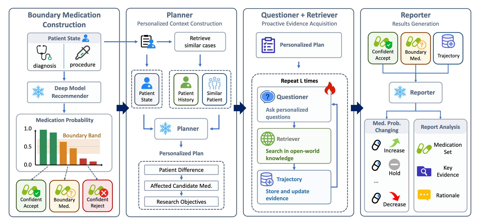

<h2 align="center">MedDR: Causality-Guided Proactive Research Agents for Personalized Medication Recommendation</h2>

<p align="center">
  Xiaoyan Zhao<sup>1</sup>, Xiang Li<sup>2</sup>, Zipeng Zhan<sup>2</sup>, Chunyuan Zheng<sup>2</sup>,<br>
  Yang Zhang<sup>1,&dagger;</sup>, Weihao Liu<sup>3</sup>, Haoxuan Li<sup>2,&dagger;</sup>, Tat-Seng Chua<sup>1</sup>
</p>

<p align="center">
  <sup>1</sup>National University of Singapore<br>
  <sup>2</sup>Peking University<br>
  <sup>3</sup>Renmin University of China<br>
  <sup>&dagger;</sup>Corresponding authors
</p>

## Abstract

Medication recommendation aims to support accurate, safe, and personalized prescribing from electronic health records. Existing retrieval-augmented approaches often select evidence by semantic relevance rather than its utility for resolving medication uncertainty. MedDR reformulates this task as proactive deep research: a Planner develops patient-specific research objectives, a Questioner iteratively requests decision-relevant evidence from a frozen Retriever, and a Reporter updates uncertain medication recommendations under drug-drug interaction constraints. Counterfactual evidence interventions estimate the contribution of each research step through a necessity-and-sufficiency-inspired reward, which trains the Questioner with group relative policy optimization. The framework combines frozen deep-model predictions with evidence-grounded, personalized decision refinement.

The repository includes MedDR and a SafeDrug implementation. Datasets and pretrained weights are not included. For research use only.

## Framework



MedDR retains confident deep-model decisions and researches medications in the closed probability interval `[0.3, 0.7]`. The Planner uses same-patient history and up to three similar visits from distinct training patients to construct at most five research objectives. The Questioner performs up to five research rounds. The Reporter revises boundary-medication probabilities using the accumulated evidence and the aligned DDI graph.

The online training loop samples eight rollouts per visit. It combines the global medication-accuracy/DDI reward with step-wise PNS rewards estimated from ten Reporter samples per counterfactual condition. Group-normalized rewards update only the Questioner LoRA parameters before the next visit; the other agents and the deep recommender remain frozen. Prompts and output templates are in `LLM/meddr/prompts.py`.

## Full Pipeline

The project contains data preprocessing, SafeDrug, and the MedDR agent pipeline. Agent orchestration, prompts, counterfactual rewards, and online training are implemented in `LLM/meddr/`.

```text
MedDR/
├── data/
│   └── process.py
├── Deep_Model/
│   ├── model/
│   │   └── safedrug.py
│   └── main_SafeDrug.py
├── LLM/
│   ├── meddr/
│   │   ├── agents.py
│   │   ├── prompts.py
│   │   ├── retrieval.py
│   │   ├── pipeline.py
│   │   ├── rewards.py
│   │   ├── train.py
│   │   └── infer.py
│   ├── prepare_inputs.py
│   └── train_online.sh
├── framework.png
├── pyproject.toml
└── README.md
```

Run all commands from the repository root.

### Step 1. Install Dependencies

Use Python 3.9 or later and install the package:

```bash
python -m venv .venv
source .venv/bin/activate
python -m pip install --upgrade pip
python -m pip install -e .
```

The Planner, Questioner, and Reporter use Qwen3-8B. The example commands assume local weights at `models/qwen3-8b`.

### Step 2. Preprocess EHR Data

The preprocessing script supports MIMIC-III and adapts a workflow similar to GiantMed: diagnosis/procedure encoding, NDC-to-RxCUI-to-ATC-3 mapping, molecular filtering, and DDI construction. Obtain authorized access to the required data and place the following files in `data/raw/`:

```text
DIAGNOSES_ICD.csv
PROCEDURES_ICD.csv
PRESCRIPTIONS.csv
D_ICD_DIAGNOSES.csv
D_ICD_PROCEDURES.csv
ndc2RXCUI.txt
ndc2atc_level4.csv
idx2SMILES.pkl
drug-atc.csv
drug-DDI.csv
```

`ndc2RXCUI.txt` contains a dictionary literal, `ndc2atc_level4.csv` supplies `RXCUI` and `ATC4`, and `idx2SMILES.pkl` maps ATC-3 codes to molecular SMILES strings. Load pickle files only from trusted sources.

```bash
python data/process.py \
  --raw-dir data/raw \
  --output-dir data/ready
```

The script produces patient-level train/validation/test records, vocabularies, molecular structures, the DDI adjacency matrix, a BRICS substructure mask, and clinical-name mappings. Each visit is represented as `[diagnosis_indices, procedure_indices, medication_indices]`. The first two-thirds of patients form the training split; the remaining patients are divided into test and validation splits in that order.

DDI constraints and DDI-rate computation use `data/ready/ddi_A_final.pkl`, with rows and columns aligned to the medication vocabulary. Set `MEDDR_DDI_MATRIX` or `--ddi-matrix` to use a different path.

Visits are ordered by the earliest retained prescription time. Patients must have at least two visits after modality filtering. Vocabulary construction and frequency filtering use the full cohort; model fitting uses only the training split. Processed records omit source patient and admission identifiers. MIMIC-IV raw tables require a separate adapter to this processed schema.

### Step 3. Train SafeDrug and Export Probabilities

SafeDrug combines longitudinal diagnosis/procedure encoders with global molecular message passing and a local drug-substructure representation. Training uses BCE, multilabel-margin, and adaptive DDI losses.

```bash
python -m Deep_Model.main_SafeDrug \
  --mode train \
  --data-dir data/ready \
  --checkpoint outputs/safedrug/best.pt
```

Training defaults to Adam, an embedding dimension of 64, and batches of 32 visits. Set the execution device with `--device`. The checkpoint with the highest validation Jaccard is saved.

```bash
for split in train test; do
  python -m Deep_Model.main_SafeDrug \
    --mode predict \
    --data-dir data/ready \
    --checkpoint outputs/safedrug/best.pt \
    --split "$split" \
    --output "outputs/safedrug/${split}_predictions.json"
done
```

Predictions contain a `patient_id` and `visits` list for each patient. Each visit contains a `visit_id` and `predicted` pairs of medication index and probability for the complete vocabulary. Patient and visit indices are positional within the processed split. Target labels are omitted.

### Step 4. Prepare Personalized Research Inputs

Create `data/ready/medication_names.json` as a JSON object mapping each ATC-3 vocabulary code to a unique readable medication-class name.

```bash
for split in train test; do
  python LLM/prepare_inputs.py \
    --data-dir data/ready \
    --predictions "outputs/safedrug/${split}_predictions.json" \
    --medication-names data/ready/medication_names.json \
    --split "$split" \
    --output "data/LLM-data/${split}.jsonl"
done
```

The converter uses only earlier same-patient visits for history. Similar visits come only from training patients: it excludes the target patient, ranks diagnosis-set Jaccard similarity, keeps the best visit per other patient, and selects up to three. Binary target labels are included only for the training split. The current visit exposes diagnoses and procedures, never its medication outcomes. Labels and positional patient/sample keys are not rendered into agent prompts.

Visits without boundary medications are counted as `baseline_only_visits` and omitted from research inputs. Full-cohort evaluation combines MedDR predictions for research visits with unmodified SafeDrug decisions at threshold `0.5` for baseline-only visits. DDI constraints are derived from the aligned matrix.

```bash
python -m meddr.validate_data \
  --data data/LLM-data/train.jsonl \
  --mode training

python -m meddr.validate_data \
  --data data/LLM-data/test.jsonl \
  --mode inference
```

### Step 5. Run Online Research and GRPO Training

Configure the frozen Retriever through the runtime environment:

| Variable | Purpose |
| --- | --- |
| `MEDDR_RETRIEVER_KEY` | Runtime authentication secret |
| `MEDDR_RETRIEVER_ENDPOINT` | Complete HTTPS chat-completions endpoint |
| `MEDDR_RETRIEVER_MODEL` | Runtime model identifier |

The Retriever sends JSON chat-completions requests and reads `choices[0].message.content`. Credentials and endpoints must be supplied at runtime and excluded from version control. Patient-specific questions are sent to the configured service; use a deployment approved for the data being processed.

```bash
bash LLM/train_online.sh \
  --train-data data/LLM-data/train.jsonl \
  --questioner-model models/qwen3-8b \
  --planner-model models/qwen3-8b \
  --reporter-model models/qwen3-8b \
  --max-updates 100 \
  --output-dir outputs/meddr
```

The online loop alternates rollout collection and Questioner updates. `--max-updates` sets the number of updates. Run `bash LLM/train_online.sh --help` for all options.

For inference, use the saved Questioner adapter with the same frozen backbone, deep-model checkpoint, vocabulary, and DDI matrix:

```bash
python -m meddr.infer \
  --input-data data/LLM-data/test.jsonl \
  --questioner-model models/qwen3-8b \
  --planner-model models/qwen3-8b \
  --reporter-model models/qwen3-8b \
  --adapter-path outputs/meddr/adapter-final \
  --output-file outputs/meddr/predictions.jsonl
```

## Citation

```bibtex
@misc{zhao2027meddr,
  title={Causality-Guided Proactive Research Agents for Personalized Medication Recommendation},
  author={Zhao, Xiaoyan and Li, Xiang and Zhan, Zipeng and Zheng, Chunyuan and Zhang, Yang and Liu, Weihao and Li, Haoxuan and Chua, Tat-Seng},
  year={2027}
}
```

## Acknowledgements

We follow a data preprocessing approach similar to [GiantMed](https://github.com/lvhangkenn/GiantMed), adapt it for MedDR, and thank its authors for making their code publicly available.
